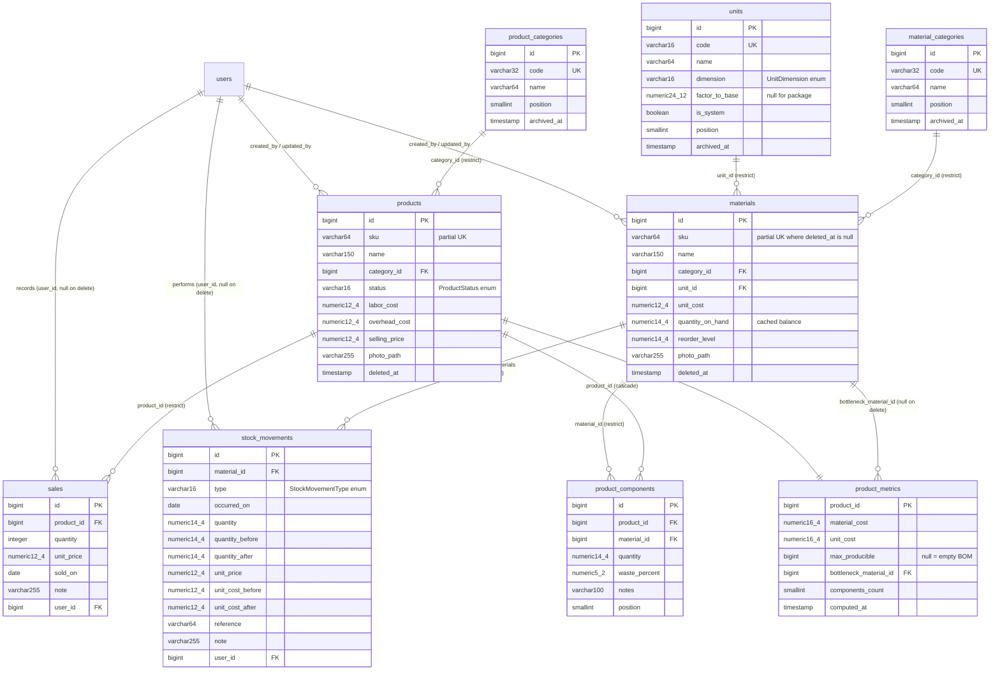

# Phase 3 — Performance, SPA data loading, reference data and database architecture

> Owner: **tech-lead** · Status: **3P delivered 2026-10-09: S-19 and S-20 approved; S-18 repo side approved, waiting for the human's machine steps (SETUP.md §4.1). The rest Proposed.** Decisions: see the end of the plan.
> Stories: S-18 … S-27 (new, `Proposed` in [BACKLOG](../BACKLOG.md)), plus amendments to the existing Phase 3 stories S-04, S-14-BE, S-15-BE,
> S-16-BE, S-06-BE, S-07-BE and S-17. ADR drafts: [0007](../adr/0007-dev-runtime-native-serving.md), [0008](../adr/0008-reference-data-in-database.md),
> [0009](../adr/0009-spa-data-loading-on-inertia.md), [0010](../adr/0010-database-architecture.md). 0007 and 0008 are **Accepted** (2026-10-08); 0009 and 0010 are **Proposed**.

## Summary: the five questions in one screen

1. **Why pages are slow.** It's mostly the dev setup, not the app. Every request runs PHP from the Windows drive `G:\` through the WSL2 9p bind mount
   (`compose.yaml:21`). OPcache re-checks every included file at most every 2 s (`revalidate_freq=2`), and a request includes 755–831 files at about
   1.4 ms per `stat` over 9p. **Measured:** `/login` takes **2.1 s** when requests are 3 s apart (normal human navigation) and **0.16 s** back to back.
   The app's own work is **32–55 ms per page with 0–3 queries and 1–9 KB of JSON**. Creation pages feel worst because you reach them after an idle
   moment on a list, and a submit is a POST plus a redirected GET. **Fix:** serve the app natively with Laragon (ADR-0007), or move the repo into WSL2.
   The app-side work below then keeps pages fast as real data grows.
2. **Fast SPA.** The app is already an SPA. Inertia 3 does client-side routing, layouts are persistent, and every internal link and form goes
   through Inertia (no full reloads found). What's missing is data-loading discipline: prefetch with cache tags, partial reloads, lazy (closure)
   props, reference data sent once per session (`Inertia::shareOnce`), deferred props for secondary panels, server-side search for the material
   picker, and dropping test code from the bundle. **No separate API + client SPA** (ADR-0001 still holds, see §B.3).
3. **Status.** Auth, materials CRUD, the costing/margin/sales maths and every page (UI) are real and green: Pest 1 286 tests, Vitest 968 tests, build OK.
   Products, BOM, sales, dashboard sales figures, material usage, stock history, restock and photos run on **preview data** (`App\Mock`, ADR-0006):
   validated but not saved. See §E.
4. **Database.** PostgreSQL, bigint identity keys, `numeric(p,s)` for every money or quantity value, reference tables for units and categories
   (FK `restrict`, archive rather than delete), soft deletes on materials and products, a cached stock balance plus an append-only `stock_movements`
   ledger, and a `product_metrics` read model so the product list can filter, sort and paginate in SQL. ER diagram in §D.2.
5. **Plan.** Quick wins first (S-18 dev runtime, S-19 frontend navigation, S-20 lazy props and query budgets). Then reference data (S-21/S-22),
   because `products` must be born with `category_id`. Then the existing real-backend stories with the amendments in §F. Last, performance budgets on
   a large dataset (S-27) and the production runtime (S-26).

---

## A. Current performance issues (measured on 2026-10-08)

### A.0 How it was measured
- The Docker stack was running (`invory-laravel.test-1`, `invory-pgsql-1`, `invory-mailpit-1`). Nothing was started or stopped.
- **HTTP:** `curl` timings against http://localhost:8000. Requests were sent back to back, then spaced 3 s apart with `curl --rate 20/m`.
- **In-process:** a read-only PHP script ([appendix](#appendix--measurement-script)) piped into the container. It boots the app, signs in an existing
  verified user on an `array` session (nothing written), sends an Inertia XHR for each page twice (**cold**: first class loads over 9p; **warm**:
  the app's own work), and counts queries with `DB::listen`. It also reports payload size and `get_included_files()`.
- **Bundle:** `npm run build` chunk report plus a walk of `public/build/manifest.json` to get each page's static-import closure.
- **Gates (unchanged code):** `composer test` → 1 286 passed · `npx vp test` → 968 passed · `npm run build` OK.

### A.1 Findings ranked by impact

| # | Severity | Where | Finding (evidence) | Cause | Fix → story |
|---|---|---|---|---|---|
| 1 | **Critical (dev)** | `compose.yaml:21` `.:/var/www/html`; container `mount` shows `G:\ on /var/www/html type 9p (… aname=drvfs …)` | `/login` **2.11–2.18 s** with 3 s gaps vs **0.16 s** back to back. Static file: 3 ms. `artisan --version`: **2.6 s real / 0.16 s user** in the container vs **0.33 s** native (Laragon, no OPcache). 2 000 `stat` calls over 9p take 2.77 s (≈1.4 ms each); a page includes **755–831 PHP files** | OPcache `validate_timestamps=1`, `revalidate_freq=2`: after 2 s idle, every included file is re-`stat`ed through 9p. Every Inertia visit, prefetch and form submit pays it | Serve natively with Laragon (or move the repo into WSL2): ADR-0007 → **S-18** |
| 2 | High (dev) | `artisan serve` (PHP built-in server, `PHP_CLI_SERVER_WORKERS=4`); Xdebug **loaded** (mode `off`); `SESSION_DRIVER=database`, `CACHE_STORE=database` | Each request is also a session read and write on PostgreSQL. The built-in server is a dev server | Starter-kit defaults | S-18 (native web server + OPcache on); production runtime S-26 |
| 3 | Medium (scale) | `ProductController.php:60` and `:95-101` → `PreviewMaterials::byName()` (`app/Mock/PreviewMaterials.php:54-57`) | Product create/edit send **every** material as `materials` (2.2 KB for 13 rows ≈ 170 B/row → ~340 KB at 2 000 materials). `material-combobox.tsx:136-185` renders every option, unvirtualized, when open | Eager "all rows" prop; no server-side search | Server-side typeahead for the picker → **S-25** |
| 4 | Medium (scale) | `InventorySummary.php:48-61`, called from `MaterialController.php:165` and `DashboardController.php:42` | Every materials list and dashboard visit scans **all** materials (`lazyById(500)`) to sum stock value in PHP, even when only the table changes (filter, sort, page) | Exact maths can't use SQL `SUM` because SQLite sums in floats (the comment says so); prop isn't lazy | Lazy closure + `only` partial reloads (S-19/S-20); versioned cache of the summary (S-23) |
| 5 | Medium (scale, Phase 3 design) | `PreviewProducts::filter()` / `listItems()` (`app/Mock/PreviewProducts.php:203-215, 273-299`), `DashboardController.php:35-53` | Products list "can't produce", capacity, bottleneck and the dashboard alerts need **every** product costed per request. Fine for 7 fixture products, O(products × lines) once real | No persisted derived data | `product_metrics` read model (ADR-0010) → **S-23** |
| 6 | Medium | `pages/materials/index.tsx:114-117`, `pages/products/index.tsx:101-104`, `pages/sales/index.tsx:124-127`, `pages/dashboard.tsx:38-41` | Filter, sort and period changes reload **all** props (summary, options, totals, deferred history) | No `only` partial reloads; props are eager values, so the server computes them anyway | **S-19** (`only`) + **S-20** (closures) |
| 7 | Medium | `nav-main.tsx:62-64` and `app-sidebar.tsx:51` prefetch; `pages/materials/index.tsx:134,158`, `pages/products/index.tsx:121,146`, table row links: no prefetch | Only the sidebar prefetches. "Add material", "New product", "Edit" and row links wait for the server on click | Not configured | **S-19** (`prefetch` + `cacheTags` / `invalidateCacheTags`) |
| 8 | Low (prod) / hygiene | `resources/js/app.tsx:140-166` (no `resolve`, so `@inertiajs/vite` globs `./pages/**/*.tsx`) | **13 `*.test-*.js` chunks** plus a **506 KB** chunk (`inertia-DO4khEi5.js`: vitest, chai, testing-library, `react-dom/test-utils`) and test fixtures (`products-*.js`, `sales-*.js`) ship in `public/build`. They're never requested, but they're deployed and inflate the manifest (35.6 KB) | Page tests sit in `pages/` (backlog F-13) | **S-19** |
| 9 | Low | `MaterialController.php:181,197-198,233-234`, `ProductController.php:48-49,58-59,99-100`, `SaleController.php:39-40`, `DashboardController.php:39` | Option lists (categories, units, statuses, periods, every product) are rebuilt and re-sent on every visit (~0.3–2 KB each). Today that's free (enums); after S-21 each list is a query per page | Per-page props | `Inertia::shareOnce(...)->as('reference:v{n}')` → **S-21/S-22** |
| 10 | Low | `HandleInertiaRequests.php:311-313` | The full `User` model is in every response (236 B today; any future column leaks) | Starter-kit default (F-03) | **S-20** |
| 11 | Low (scale) | `Material.php:110-112` `whereLike('%term%')` | A leading wildcard can't use the `name` b-tree index (`create_materials_table.php:32`) | — | `pg_trgm` GIN index on PostgreSQL (ADR-0010) → S-21 (materials), S-04 (products) |
| 12 | Low (future) | S-15-BE (photos up to 4 MB) | Tables show 25 thumbnails per page. Serving originals would make list pages tens of MB | Not built yet | Generate a thumbnail and a medium WebP variant on upload (GD with WebP is available in the container) → S-15-BE amendment |
| 13 | Info (build) | Vite plugin timings | `@laravel/vite-plugin-wayfinder buildStart` takes 9.8 s of a 13.4 s build | Wayfinder regenerates every route | Not a runtime issue. Watch it |
| — | Not an issue | `components/products/bom-editor*.tsx`, React Compiler on | No measurable re-render problem at current sizes. The picker list mounts only while open (one at a time) | — | Add a 50-row / 2 000-material render test in S-25 |
| — | Not an issue | Navigation | Every internal link is `<Link>`; forms use `<Form>` / `useForm` (`product-form.tsx:245`, `sale-form.tsx:212` call `form.post/put`). No `window.location`, no `<a href>` to app pages, no forced full reloads. `passkey-verify.tsx:34` uses `router.visit` | — | — |
| — | Not an issue | Vite dev vs build | No `public/hot`, so the app serves the **built** bundle. If `npm run dev` is running, the first page load transforms ~200 modules through Babel (React Compiler); later loads are cached | — | Documented in S-18 |

### A.2 Per-page server profile (in-process, existing verified user)

| Page (Inertia XHR) | Cold (first class load, 9p) | **Warm (app work)** | Queries | JSON | Biggest props |
|---|---|---|---|---|---|
| `/dashboard` | 625 ms | **55 ms** | 3 | 6.7 KB | stats, top products, recent sales (fixture) |
| `/materials` | 741 ms | **51 ms** | 3 (summary scan, count, page) | 8.9 KB | `materials` page, `summary` |
| `/materials/create` | 480 ms | **32 ms** | 0 | 1.5 KB | `categories`, `units` |
| `/materials/2` | 537 ms | **36 ms** | 2 | 1.0 KB | — |
| `/materials/2/edit` | 565 ms | **42 ms** | 1 | 2.0 KB | — |
| `/products` | 718 ms | **42 ms** | 1 | 4.7 KB | `products` |
| `/products/create` | 514 ms | **37 ms** | 1 (`select * from materials … order by name`) | 3.1 KB | `materials` (all) |
| `/products/1` | 532 ms | **38 ms** | 1 | 4.3 KB | `product` |
| `/products/1/edit` | 540 ms | **44 ms** | 1 | 5.6 KB | `materials` 2.2 KB, `product` 2.5 KB |
| `/sales` | 721 ms | **45 ms** | 0 | 8.5 KB | `sales`, `products` |

Payloads are small and there's no N+1 today. All the slowness is in the "cold" and HTTP columns, which come from the environment (finding 1).

### A.3 Frontend bundle (production build)
- Pages are **lazy** (`import.meta.glob` with `eager: false`). Layouts are **persistent** (`createInertiaApp({ layout })`, `app.tsx:142-153`). The root
  view modulepreloads the current page chunk (`resources/views/app.blade.php`, `@vite([... pages/{component}.tsx])`).
- Entry closure: **566 KB raw ≈ 180 KB gzip**: `jsx-runtime` (React + React DOM) 220 KB, `wayfinder` (Inertia core + qs + route helpers) 157 KB,
  `app` (shell, sidebar, sonner, tooltip) 159 KB.
- Per page: 568–653 KB raw. The heaviest is **products create/edit: 653 KB** (`product-form` 47.6 KB raw / 16.6 KB gzip, with cmdk).
  That's acceptable for an internal SPA. No heavy library is pulled into every page, and the TS sources have no large static datasets
  (the test fixtures are bundled only because of finding 8).

### A.4 Dev vs app: conclusion
| Slow because of the dev setup | Slow because of the app (now or at scale) |
|---|---|
| 9p bind mount + OPcache revalidation (≈2 s per request after idle), built-in PHP server, Xdebug loaded, database sessions | Eager "all materials" picker prop, full inventory scan per list visit, per-request costing of every product (once real), full-prop reloads on filter changes, little prefetching, test chunks in the build |

---

## B. SPA approach

### B.1 What we already have
Inertia 3.8 (`@inertiajs/react` 3.8.0, `inertiajs/inertia-laravel` v3.5.1) is an SPA protocol: the first load is HTML; later visits are XHRs that
return a JSON page object, and React swaps the page. Layouts persist across visits. The progress bar is configured (`app.tsx:163-165`).
`Inertia::defer` is already used once (`MaterialController.php:188`, the history panel, `<Deferred>` in `history-panel.tsx:56`).

### B.2 What's missing, and the Inertia 3 feature for each (APIs verified in `vendor/inertiajs/inertia-laravel/src/ResponseFactory.php` and `node_modules/@inertiajs/react/types/index.d.ts`)

| Need | Inertia 3 feature | Where | Story |
|---|---|---|---|
| Server answers in < 150 ms | (environment) | Native serving + OPcache | S-18 |
| Instant clicks | `<Link prefetch>` (hover, 75 ms) with `cacheFor` (default 30 s) and **`cacheTags`**; forms pass **`invalidateCacheTags`**; `usePrefetch` to show "prefetched" state where needed | Primary CTAs (Add material, New product, Edit, Record a sale), table row name links, breadcrumbs, dashboard KPI links. Tags: `materials`, `products`, `sales`, `reference` | S-19 |
| Filters don't recompute everything | **Partial reloads** `router.get(url, query, { only: [...] })` | materials/products/sales index (`only: ['materials','filters']` etc.), dashboard period (`except: ['needs_restock','alerts']`) | S-19 + S-20 |
| Server skips unrequested props | **Lazy props**: wrap every non-trivial prop in a closure (`fn () => …`). Inertia evaluates a closure only when the prop is part of the response | every controller | S-20 |
| Reference data once per session | **Once props**: `Inertia::shareOnce('reference', fn () => ReferenceData::all())->as('reference:v'.$version)`. The client sends the keys it already holds (`X-Inertia-Except-Once-Props`) and the server skips them. Bumping `$version` (cache key, incremented by reference-data Actions) forces a resend | units, material categories, product categories, product statuses, sales periods, stock statuses | S-21/S-22 |
| Fast first paint on heavy pages | **Deferred props** `Inertia::defer(fn, group)` + `<Deferred>` skeletons; **`WhenVisible`** for below-the-fold panels | dashboard (top products, recent sales, alerts in a group), material show (history, usage), product show (recent sales) | S-24 |
| Data only when asked | **Optional props** `Inertia::optional(fn)` (never sent unless requested with `only`) | material history "show all"; product picker results if done as a page prop | S-24 / S-25 |
| Typeahead without page visits | **`useHttp`** (Inertia 3) against a small session-authenticated JSON route `GET /materials/options?search=&limit=20` | BOM editor material picker; sales "Record a sale" product picker once products are many | S-25 |
| Long lists | **Infinite scroll**: `Inertia::scroll($paginator)` + `<InfiniteScroll>` (merge props) | stock history panel ("Load more"), sales log on mobile. Optional: classic pagination stays the default | S-24 (optional) |
| Snappy writes | **Optimistic updates**: `router.optimistic(cb)` / `form.optimistic(cb)` | delete sale, archive reference item, restock quick form (stock figure). **Not** for cost or capacity (server-computed only) | S-24 |
| BOM editing feedback | The editor already edits locally (form state). Live cost while editing is **S-09** (debounced `useHttp` POST `/products/cost-preview`; the server stays the source of truth) | product form | S-09 (stretch) |
| Background refresh | `usePoll` | **Not recommended now**: one company, few users. Revisit for a shared dashboard on a wall screen | — |
| Progress feedback | `progress` (already on; delay 250 ms) and `showProgress: false` for prefetch and background reloads | app.tsx | S-19 |

### B.3 Separate REST API + client-side SPA? **No.**
- ADR-0001 chose Inertia so there is one deployable, session auth, server-side validation and one typed contract (`domain.ts`, Wayfinder).
  A client SPA + API would add token auth and CORS, a second routing layer, API versioning, client caching (React Query or similar) and a duplicated
  contract, and it would **not** fix finding 1. The latency is in PHP boot over 9p, which an API pays too.
- Everything a client data library would give us (prefetch, caching with tags, partial and deferred loading, merge and infinite scroll, optimistic
  updates, plain HTTP calls through `useHttp`) is built into Inertia 3.
- Small internal JSON routes for typeahead (S-25) and cost preview (S-09) live in `routes/web.php` behind `auth` + `verified` + policies. They are
  not a public API and use the same Actions and Resources. A public `/api/v1` (Sanctum) stays a post-MVP item (ARCHITECTURE §10) for mobile or
  integrations.

### B.4 Performance budgets (acceptance targets, checked by S-27 on the large dataset)
| Metric | Budget |
|---|---|
| Authenticated Inertia visit, server time, dev native, with 3 s gaps | p95 ≤ 150 ms |
| Same in production runtime (S-26) with 2 000 materials / 500 products / 50 000 sales | p95 ≤ 100 ms |
| Queries per page (no N+1) | ≤ 10, asserted by Pest "query budget" tests (S-20 and every Phase 3 BE story) |
| Inertia JSON per visit (excluding the 25-row page of a list) | ≤ 50 KB raw |
| JS entry closure | ≤ 200 KB gzip (today ≈ 180) · any page chunk ≤ 30 KB gzip (today max 16.6) |
| Prefetched navigation | page swap ≤ 100 ms after click |

---

## C. Hard-coded data → database

### C.1 Inventory of hard-coded lists

| Item | Lives today | Decision | Why |
|---|---|---|---|
| **Units of measure** (m, cm, yd, sqm, sqft, kg, g, l, ml, pc, pair, roll, cone) | `app/Enums/UnitOfMeasure.php:9-38`; `domain.ts:43-56` union; `materials.unit` string (`create_materials_table.php:19`); `DemoCatalogSeeder.php`, `MaterialFactory`, `App\Mock\PreviewFixture` | **DB table `units`** (user can add, rename and archive) + **PHP enum `UnitDimension`** (length, area, mass, volume, count, package) for behaviour | Companies use units we didn't list (inch, dozen, gross, oz). Dimension and factor drive future conversion maths, so they stay typed |
| **Material categories** (fabric … other) | `app/Enums/MaterialCategory.php:9-20`; `domain.ts:30-42`; `materials.category` string (`create_materials_table.php:18`); seeder, factory, fixture | **DB table `material_categories`** | Pure classification, no behaviour. Users want their own (e.g. "Elastic", "Zipper", "Embroidery") |
| **Product categories** (apparel … other) | `app/Enums/ProductCategory.php:9-14`; `domain.ts:144-150`; `App\Mock` | **DB table `product_categories`** | Same reason |
| Product status (draft, active, archived) | `app/Enums/ProductStatus.php:9-11` | **Stay a PHP enum** | Behaviour: only `active` can be sold (costing skill) |
| Stock status (in_stock, low, out) | `app/Enums/StockStatus.php:9-11` | **Stay a PHP enum** | Computed from stock and reorder level |
| Stock movement type | `app/Enums/StockMovementType.php:9-12` | **Stay a PHP enum** | Each type has its own write logic in Actions |
| Sales period | `app/Enums/SalesPeriod.php:11-14` | **Stay a PHP enum** | Date maths (`range()`) |
| Currency, locale | `config/invory.php:16` (`APP_CURRENCY`, default TND); `app()->getLocale()` | **Stay in config (recommended)**: installation settings, not master data. Changing the currency only relabels amounts and converts nothing. Alternative: a one-row `company_settings` table edited in Settings (decision Q6) | Avoid a footgun; one company |
| Pagination size | `config/invory.php:27` | Stay in config | Technical |
| Colour, composition, supplier | free-text columns on `materials` | **Stay free text** for now. `suppliers` table is a later story (ADR-0010 lists it) | No requirement yet |
| Sizes / variants | — | Not in scope (ARCHITECTURE §10) | — |
| Preview fixtures (7 products, 60 sales, stock history, photos) | `app/Mock/*`, `public/mock/photos/*` | **Demo data, not master data.** Replaced by real tables story by story (ADR-0006); the demo set moves to `DemoCatalogSeeder` (S-17, S-08) | — |
| Demo materials (12) | `database/seeders/DemoCatalogSeeder.php` | Stays a **dev/demo seeder**, keyed by SKU, now referencing unit and category **codes** | — |
| Labels in TS | none (labels already come from the server as `Option[]` and `*_label`) | — | Good: no frontend label maps to remove |

### C.2 Reference tables (full DDL in §D.3)
`units`, `material_categories` and `product_categories` share one shape:

- `id` bigint PK
- `code`: immutable, unique, `[a-z0-9_]{1,32}`. Used in URLs, filters and seeds; `'m'` stays `'m'`.
- `name`: editable label, unique among non-archived rows.
- `position`: sort order.
- `archived_at`: archived rows are hidden from pickers and filters but still show on existing records.
- `is_system` (units only): the seeded defaults can't change dimension or factor or be deleted, only renamed or archived.
- Timestamps.

Rules:
- **Delete** only when unused (`ReferenceInUseException`, error toast with the count). Otherwise **archive**.
- Materials and products reference them with `foreign … restrictOnDelete`.
- Writes go through Actions (`CreateUnit`, `UpdateUnit`, `ArchiveUnit`, `DeleteUnit`, and the same for both category tables). Each one bumps the
  reference version (cache key `invory.reference.version`).
- Policies: `UnitPolicy`, `MaterialCategoryPolicy`, `ProductCategoryPolicy`. MVP: any verified user (decision Q3), ready for an admin role later.

### C.3 Units: dimension and conversion design
- `units.dimension` (`UnitDimension` enum) and `units.factor_to_base numeric(24,12) null`, stored and read as decimal strings and used only through
  `BigDecimal`. One base unit per dimension has factor `1`.
  Defaults:

  | Dimension | Base | Defaults (factor to base) |
  |---|---|---|
  | length | m | cm 0.01, yd 0.9144 |
  | area | sqm | sqft 0.09290304 |
  | mass | kg | g 0.001 |
  | volume | l | ml 0.001 |
  | count | pc | pair 2 |
  | package | — | roll, cone (null) |

- `package` units have **no generic factor**: a roll of denim and a cone of thread hold different lengths per material. A later
  `material_unit_conversions(material_id, unit_id, factor_to_material_unit)` covers them.
- **Phase 3 keeps the costing rule "a BOM quantity is always in the material's own unit".** No conversion maths ships now, so the costing domain and
  the golden test are unchanged. The columns let the conversion story (later) add `product_components.unit_id` and a pure
  `App\Domain\Units\UnitConverter`: `qty_material = qty × f_line ÷ f_material`, divided at scale 12 with `RoundingMode::HalfUp` before
  `effective_qty`. That needs a costing-skill update and an ADR when it's scheduled.
- **New rule (S-21):** a material's unit **can't change while any non-deleted product's BOM uses it**. Otherwise every BOM quantity silently changes
  meaning. Today `UpdateMaterial` allows it. This needs a skill update when accepted (decision Q7).

### C.4 Migrating existing rows (S-21, one migration, reversible, tested on SQLite and PostgreSQL)
1. Create `units`, `material_categories` and `product_categories`, and insert the current enum values as defaults (codes unchanged; names = today's
   English labels without the "(m)" suffix; units also get `dimension`, `factor_to_base` and `is_system = true`) with `insertOrIgnore` keyed by
   `code`, so the migration is idempotent.
2. `materials`: add nullable `unit_id` and `category_id`; backfill with portable correlated subqueries
   (`UPDATE materials SET unit_id = (SELECT id FROM units WHERE units.code = materials.unit)`). **Abort** with a clear message if a row has a code
   that isn't in the defaults (none exist, because the enum cast prevents it).
3. Make the FKs not null (`->change()`, supported on SQLite by table rebuild in Laravel 13), drop `materials.unit` and `materials.category`, and move
   `index(category)` to `index(category_id)` and add `index(unit_id)`.
4. `down()` restores the string columns from the codes and drops the tables.
5. `App\Mock` fixtures and `DemoCatalogSeeder` switch from enum cases to codes in the same story (they're consumers).

### C.5 Seeding strategy
- **Required defaults live in migrations, not seeders.** The FKs are `NOT NULL`, so the app can't work without them. A migration guarantees they exist
  in every environment (production `migrate --force`, CI, and every `RefreshDatabase` test) with no extra step. The migration inlines a frozen
  snapshot of the defaults; it doesn't import app classes, so later refactors can't change history. Adding a default later = a new migration with
  `insertOrIgnore` by code.
- **Demo data lives in seeders**: `DemoCatalogSeeder` (`updateOrCreate` by SKU, idempotent), later the full demo set (S-08), and a dev-only
  `PerformanceDatasetSeeder` (S-27). `DatabaseSeeder` refuses to run demo seeders in production.

### C.6 Contract changes (deliberate exceptions to ADR-0006's "props don't change", one vertical commit per story)

```ts
// domain.ts (S-21a writes it; S-22 consumes it)
export type ReferenceOption = { id: number; code: string; name: string; archived: boolean };
export type UnitOption = ReferenceOption & { dimension: UnitDimension; factor_to_base: Decimal | null; is_system: boolean };
export type UnitDimension = 'length' | 'area' | 'mass' | 'volume' | 'count' | 'package';
export type ReferenceData = {
    units: UnitOption[]; material_categories: ReferenceOption[]; product_categories: ReferenceOption[];
    product_statuses: Option<ProductStatus>[]; sales_periods: Option<SalesPeriod>[]; stock_statuses: Option<StockStatus>[];
};
// MaterialCategory, UnitOfMeasure, ProductCategory become `string` (codes). Material gains category_id, unit_id;
// MaterialFormData / ProductFormData submit category_id / unit_id (number | ''). Filters keep codes in the URL (?category=fabric).
// global.d.ts sharedPageProps gains `reference: ReferenceData` (once-prop). Per-page `categories`, `units`, `statuses`, `periods` props are removed.
```

### C.7 Screens (S-22)
Settings gets a **"Catalogue"** group with three pages: **Units**, **Material categories** and **Product categories**. Each page has:
- a table: name, code, (units: dimension, factor), usage count, status (active or archived)
- a create/edit dialog (the code is editable only on create)
- archive and restore actions, and delete with a confirm dialog (disabled with the reason when the item is in use)
- empty states, and support for 375 px and dark mode

Material and product forms and filters read `usePage().props.reference` and hide archived items, except an item the record already uses.

---

## D. Database architecture (PostgreSQL 18; SQLite in-memory for the fast suite only)

### D.1 Principles (ADR-0010)
- **Primary keys: bigint identity** (`$table->id()`), not ULID. Reasons:
  - `materials` already uses bigint.
  - Routes are constrained to digits (`routes/web.php:16,24`) and Wayfinder types the parameters as numbers.
  - Indexes and FKs stay half the size and in insert order.
  - One company, so there is no distributed id generation, and authorization is done by policies, not by hard-to-guess ids.
  - If a public API ever needs opaque ids, add a `public_id` ULID column then.
- **Money and quantities:** `numeric(p,s)`. Never `float`/`double`. Casts `decimal:4` / `decimal:2` give strings, and the maths uses `BigDecimal`
  (ADR-0002). Scales: unit costs and prices `numeric(12,4)`, quantities `numeric(14,4)`, waste `numeric(5,2)`, unit factors `numeric(24,12)`,
  derived costs in `product_metrics` `numeric(16,4)`.
- **Integrity in the database too:** FKs everywhere, with the on-delete behaviour in §D.3. `CHECK` constraints for ranges (≥ 0, waste < 100,
  sale quantity 1 … 1 000 000) on **PostgreSQL** via `DB::statement` guarded by driver (SQLite relies on validation). Partial unique indexes
  `WHERE deleted_at IS NULL` for SKUs.
- **Soft deletes:** `materials` and `products` (history, restore, BOM lines kept). **No soft deletes** on reference tables (archive instead), BOM
  lines (child rows), the ledger (append-only) and `sales` (hard delete of a mistaken entry, decision Q8).
- **Audit:** `stock_movements.user_id` and `sales.user_id` (exist in the design), plus `created_by` / `updated_by` (FK users, `nullOnDelete`) on
  `materials` and `products`. Timestamps are `timestamp(0)` in the app timezone (Laravel default). Dates of business events are `date`
  (`sold_on`, `occurred_on`).
- **Derived data is never typed in by hand.** Costing results are computed by `App\Domain\Costing` and, when SQL needs to filter or sort on them,
  persisted in a **read model** refreshed inside the same transaction as the write (no queue, so it is never stale).
- **Exact aggregates:** money sums stay in PHP with `BigDecimal` over narrow `lazyById` cursors (portable and exact). Results that are expensive and
  read often (inventory summary, period sales totals) are cached under a **version key** bumped by the Actions that change their inputs. Revisit
  PostgreSQL `SUM(numeric)` (exact) only if volumes outgrow this, which would mean dropping SQLite for those tests (new ADR).

### D.2 ER diagram


Framework tables (`users`, `sessions`, `cache`, `jobs`, `passkeys`, `password_reset_tokens`) are unchanged.
**Later** (designed, not scheduled): `suppliers` (+ `materials.supplier_id`), `material_unit_conversions`, `product_variants`, `production_runs`
(consumption of stock, decision Q9), `team_id` scoping (ADR-0003).

### D.3 Tables: column details beyond the diagram
- **`materials`** (exists): + `category_id`, `unit_id` (S-21) · `photo_path` (S-15-BE) · `created_by`, `updated_by` (S-21) · the other columns as in
  ARCHITECTURE §4 (supplier_name, supplier_reference, color, composition, notes). CHECKs (PG): `unit_cost >= 0`, `quantity_on_hand >= 0`,
  `reorder_level >= 0`.
- **`products`** (S-04): as ARCHITECTURE §4 but `category_id` FK instead of a `category` string; `status` default `active`; CHECKs on the costs and
  price (≥ 0).
- **`product_components`** (S-04): `unique(product_id, material_id)` (also serves lookups by product); `index(material_id)` (usage, "used in", delete
  guard); CHECK `quantity > 0`, `waste_percent >= 0 AND waste_percent < 100`.
- **`product_metrics`** (S-23): one row per product, `product_id` PK, written only by `App\Actions\Products\RefreshProductMetrics` (calls
  `CostingCalculator`). Indexes on `max_producible` and `unit_cost` (sort and "can't produce"). Margin is not stored: it's computed on read by
  `MarginCalculator` (cheap, and `selling_price` lives on `products`).
- **`sales`** (S-14-BE): CHECK `quantity BETWEEN 1 AND 1000000`, `unit_price >= 0`; the total is computed, never stored.
- **`stock_movements`** (S-16-BE): append-only (no update or delete Actions). `quantity_after` is always set, so the balance can be rebuilt and
  checked.

### D.4 Indexes vs the queries the UI runs

| UI query | Index |
|---|---|
| Materials list: `deleted_at IS NULL`, search name/SKU, category, sort by name / sku / quantity / cost / updated, paginate 25 | partial unique `sku`; `name`; `category_id`; **PG `pg_trgm` GIN** on `name` and `sku` (`CREATE EXTENSION IF NOT EXISTS pg_trgm`, PG only); others are cheap sorts at this size |
| "Needs restock" (`quantity_on_hand <= reorder_level` or `<= 0`) | none (column-to-column compare); small result; revisit at > 50 k materials |
| Material usage / "used in" / delete guard | `product_components(material_id)` |
| Products list: search, category, status, "can't produce", sort, paginate | partial unique `sku`; `name`; `category_id`; `status`; `product_metrics(max_producible)`; PG trigram on `name`, `sku` |
| Product detail + BOM | `unique(product_id, material_id)` |
| Sales log by period, product, newest first | `sales(sold_on, id)`, `sales(product_id, sold_on)` |
| Sold (30 d) per product on the list page | `sales(product_id, sold_on)` (integer `SUM(quantity)` is exact on both engines) |
| Material history, newest first | `stock_movements(material_id, occurred_on, id)` |

### D.5 Stock: cached balance + ledger (not ledger-only)
`materials.quantity_on_hand` stays the **authoritative cached balance**, because capacity maths reads it on every page. Every change goes through an
Action that, inside one `DB::transaction` with **`lockForUpdate()` on the material row**:
1. updates the balance (and `unit_cost` when relevant)
2. appends `stock_movements` row(s): `created`, `restock` (+ `price_change`), `correction`
3. refreshes `product_metrics` for the products using that material (S-23)

The ledger answers history and audit. A `invory:stock:verify` command (S-16-BE) recomputes balances from the ledger and reports drift. Sales don't move
stock (costing skill). Production consumption is a later product decision (Q9).

### D.6 Replacing the Phase 2 preview data
Unchanged from ADR-0006. Each backend story swaps its controller bodies to Eloquent + Resources and deletes its `App\Mock` part:

| Story | Replaces | Deletes |
|---|---|---|
| S-04 | products | the products fixture |
| S-14-BE | sales | the sales fixture |
| S-16-BE | history and restock | `PreviewHistory` |
| S-15-BE | photos | `public/mock/photos` (after S-17) |
| S-06-BE | dashboard | — |
| S-07-BE | usage | — |
| S-17 | — | `app/Mock`, the `access-preview` gate; moves the demo set into `DemoCatalogSeeder` |

New here: S-21 runs **before** S-04, so `products` is created with `category_id`, and S-23 makes the list and dashboard SQL-driven.

### D.7 Conflicts with existing docs (resolved when the ADRs are accepted)
- **Costing skill §"Units and categories"** lists fixed enums. Becomes "seeded defaults, user-manageable (ADR-0008)". Also: the "unit locked while
  used" rule; `UnitDimension`. The maths is unchanged.
- **ARCHITECTURE §4**: `materials.category` / `unit` strings → FKs; new tables `units`, `material_categories`, `product_categories`,
  `product_metrics`; `created_by`/`updated_by`. **§10**: "Unit is an enum with a single owner" → units are data with dimension and factor;
  `product_metrics` moves from "post-MVP" into Phase 3.
- **ADR-0005**: runtime = Sail → ADR-0007 proposes native serving (Sail keeps PostgreSQL and Mailpit; the app container stays for parity runs).
- **ADR-0006**: "pages, routes and props do not change" gets two named exceptions: reference options become one shared once-prop (S-21/S-22),
  and the product picker becomes a search (S-25).

---

## E. Current status (from code, tests and docs, 2026-10-08)

| Area | State | Evidence |
|---|---|---|
| Auth (login, register, reset, email verify, 2FA, passkeys, profile, security) | **Real** (starter kit) | `routes/settings.php`, Fortify, Pest suite |
| Materials CRUD, search, category, needs-restock filter, sort, pagination, stock status/value, inventory summary | **Real, production-ready** (photo upload validated but not stored) | `MaterialController`, `Material`, `InventorySummary`, migration; feature tests; PG parity in CI |
| Costing engine, margin, next limit, sales maths | **Real**, pure, 100 % branches | `app/Domain/Costing`, `app/Domain/Sales` |
| Theme, shell, shared UI, every page (dashboard, materials, products, BOM editor, sales) | **Real UI**, final contract | `resources/js/**`, 968 Vitest tests |
| Products, BOM, product create/edit/delete | **Preview**: costed from real materials, writes validated and **not saved** | `ProductController` + `App\Mock` |
| Sales log, record/edit/delete sale, dashboard sales KPIs, top 5, recent sales, alerts | **Preview** | `SaleController`, `DashboardController` + `App\Mock` |
| Material "used in", usage / next limit, stock history, restock | **Preview** | `PreviewMaterials::decorate`, `PreviewHistory`, `MaterialRestockController` |
| Photos | **Preview** (SVG swatches, uploads ignored) | `public/mock/photos` |
| Delete guard "material in use" | **Missing** (UI disables the button only) | ADR-0006 consequence |
| Reference data in DB, settings screens | **Missing** | this plan |
| Production runtime / deploy | **Missing** | ADR-0005 note |
| E2E smoke, full demo seed | **Missing** (S-08) | — |
| Gates today | `composer test` 1 286 ✓ · `npx vp test` 968 ✓ · `npm run build` ✓ (500 kB chunk warning = the test chunk) | run by the tech-lead on 2026-10-08 |
| Phase 2 sign-off | Waiting for the human click-through | BACKLOG |

---

## F. Task breakdown

### F.1 Order and parallelism
```
Phase 3P  quick wins (no schema, start now)    S-18 (TL + human) ∥ S-19 (FE) ∥ S-20 (BE)
Phase 3R  reference data                        S-21a (BE contract + stubs) → S-21b (BE) ∥ S-22 (FE)
Phase 3   real backend (existing, amended)      S-04 → S-14-BE ∥ S-16-BE ∥ S-15-BE ∥ S-25 (BE+FE)
                                                → S-23 (product_metrics) → S-06-BE ∥ S-07-BE → S-24 (BE+FE) → S-17
Phase 4                                         S-27 (perf dataset + budgets) ∥ S-08 (E2E, demo seed) → S-26 (production runtime)
```

### F.2 New stories

**S-18 · Dev runtime performance** · TL (docs) + human (machine config) · **S** · depends on decision Q1 · parallel with S-19, S-20
- Accept ADR-0007 and write SETUP.md §"Serve natively". Steps for the recommended option:
  - Laragon: enable `zend_extension=opcache` with `opcache.enable=1`, `opcache.validate_timestamps=1`, `opcache.revalidate_freq=0` (native NTFS
    makes stats cheap).
  - Serve through Laragon's Apache or nginx (e.g. `invory.test` → `G:\Projects\Invory\public`).
  - `.env`: `DB_HOST=127.0.0.1`, `MAIL_HOST=127.0.0.1`, `MAIL_PORT=1026`.
  - Keep Docker for `pgsql` and `mailpit` (`docker compose up -d pgsql mailpit`) and the `laravel.test` container for parity runs.
  - Disable Xdebug when not debugging. Optionally `SESSION_DRIVER=file`.
- **Acceptance:** with 3 s gaps, `/login` p95 ≤ 150 ms and authenticated pages p95 ≤ 150 ms (probe script); the parity suite still runs in the
  container.

**S-19 · SPA navigation quick wins (frontend)** · FE · **S** · no dependency · parallel with S-18, S-20
- Exclude tests from the page bundle (F-13): an explicit `resolve` in `app.tsx` with `import.meta.glob(['./pages/**/*.tsx', '!./pages/**/*.test.tsx'])`,
  or move page tests to `resources/js/tests/pages/`. **Acceptance:** no `*.test-*.js` or vitest chunk in `public/build/manifest.json`.
- `prefetch` on the primary CTAs, row name links, breadcrumbs and dashboard KPI links, with `cacheTags` by module. Every `<Form>` / `useForm` /
  `router.delete` passes `invalidateCacheTags` for the modules it changes.
- Partial reloads: filter, sort and pagination visits on the materials, products and sales lists use
  `only: [<list>, 'filters', <totals when filtered>]`; the dashboard period uses `except: ['needs_restock']`.
- `showProgress: false` on prefetches.
- **Tests:** Vitest asserts the `only` / `invalidateCacheTags` options passed to the mocked router (`test/inertia.tsx` helper); a Link prefetch prop
  test.

**S-20 · Lazy props, query budgets, explicit `auth.user` (backend)** · BE · **S** · no dependency · parallel with S-18, S-19
- Wrap every non-trivial prop in closures (materials index `summary`, `recent_history` stays deferred, sales `totals`/`products`, dashboard sections)
  so partial reloads skip them. **No prop names or shapes change.**
- F-03: share `auth.user` as an explicit array (id, name, email, avatar, email_verified_at, two_factor_enabled if the starter-kit UI reads it). Check
  `types/auth.ts`.
- Add a Pest helper `expectQueryBudget(fn, max)` and a test per page. Add partial-reload tests (`X-Inertia-Partial-Data`) proving that `summary` isn't
  computed on a filter reload.

**S-21 · Reference data in the database (backend)** · BE · **L** · depends on decisions Q2, Q3, Q7 · before S-04
- S-21a (contract wave):
  - `domain.ts` per §C.6 and `global.d.ts` `reference`
  - routes: `settings/units`, `settings/material-categories`, `settings/product-categories` (resource: index, store, update, destroy, plus
    `PATCH …/{id}/archive` and `…/restore`)
  - page stubs
  - type-compat edits in the FE fixtures (memory gotcha: changing contract types ripples)
- S-21b:
  - migrations §C.4 (+ PG `pg_trgm` indexes on materials, + `created_by`/`updated_by`)
  - `UnitDimension` enum; models with factories
  - Actions with the in-use guard and a version bump; policies; FormRequests (`code` regex, unique, immutable)
  - `ReferenceData` service, and `HandleInertiaRequests` `shareOnce('reference')->as('reference:v'.$version)`
  - Materials use FKs (create/update/filter/Resource add `category_id`, `unit_id`); the unit-locked-while-used rule
  - `App\Mock` and `DemoCatalogSeeder` on codes; delete the `MaterialCategory`, `UnitOfMeasure` and `ProductCategory` enums
- **Tests:** backfill of every old code; migration down/up; idempotent defaults; CRUD; archive hides from options but keeps on records; delete
  blocked when in use; once-prop omitted when the `X-Inertia-Except-Once-Props` header lists the key and resent after a version bump; PG parity.

**S-22 · Reference data UI** · FE · **M** · depends on S-21a · parallel with S-21b
- Settings "Catalogue" nav group and the three list pages with create/edit dialog, archive/restore and delete confirm (§C.7).
- Material and product forms and filters read `reference` from shared props, submit ids and hide archived options (except the current value).
- **Tests:** each page, the dialog validation errors, the archived option logic, keyboard and 375 px.

**S-23 · `product_metrics` read model** · BE · **M** · depends on S-04, S-16-BE · before S-06-BE, S-07-BE
- Migration (§D.3). `RefreshProductMetrics` (by product ids, or by material id → affected products) is called inside the transactions of
  `CreateProduct`, `UpdateProduct`, `SyncProductComponents`, `UpdateMaterial`, `RestockMaterial` and `DeleteMaterial`, plus an
  `invory:metrics:rebuild` command.
- The products index filters, sorts and paginates in SQL (`cant_produce` → `max_producible = 0`).
- Versioned cache for `InventorySummary` and the period sales totals.
- **Tests:** metrics equal the calculator for the golden example after every write path; rebuild command; "can't produce" filter; query budget on
  index and dashboard.

**S-24 · Deferred and on-demand data (backend + frontend, one vertical commit)** · BE + FE · **M** · depends on S-06-BE, S-07-BE (real data)
- Dashboard: KPIs eager. Top products, recent sales and alerts go in `Inertia::defer(…, 'dashboard')` with `<Deferred>` skeletons.
- Material show: `usage` eager, `history` deferred with "Load more" (`Inertia::scroll` + `<InfiniteScroll>` or an optional prop).
- Product show: `recent_sales` deferred / `WhenVisible`.
- Optimistic delete for sales and archive for reference items.
- **Tests:** contract types mark deferred props optional; skeleton states; PHP deferred-prop assertions (`assertInertia(...)->missing(...)` then
  `loadDeferredProps`).

**S-25 · Material picker server-side search** · BE + FE · **M** · depends on S-04 · parallel with S-14-BE, S-16-BE, S-15-BE
- `GET /materials/options?search=&limit=20` (policy `viewAny`, FormRequest, `MaterialOptionResource`, trigram / ILIKE search on name and SKU,
  non-deleted only).
- The picker uses `useHttp` with a debounce (250 ms) and shows the first 20 by name when the search is empty.
- `ProductCreateProps.materials` is removed. Edit pages carry the picked materials through `product.components`.
- Render test: 50 BOM rows with the picker open, under 2 000 materials.
- **Acceptance:** product create JSON ≤ 5 KB regardless of catalogue size.

**S-26 · Production runtime** · TL (ADR) + BE · **M** · Phase 4
- Production image (FrankenPHP or php-fpm + nginx) with OPcache `validate_timestamps=0`.
- Build steps: `composer install --no-dev --classmap-authoritative`, `php artisan optimize` (config, route, event and view caches), `storage:link`.
- Static `/build` assets served with `Cache-Control: immutable` + Brotli, HTTP/2.
- Sessions and cache on Redis or the database (decide in the ADR).
- Health check.

**S-27 · Performance dataset and budgets** · BE + TL · **S** · depends on S-06-BE, S-23
- `PerformanceDatasetSeeder` (dev only): 2 000 materials, 500 products × 8 lines, 50 000 sales, 20 000 movements.
- A probe command or script records p50/p95 per page (the appendix method). Check every budget in §B.4 and record the results in this plan.

### F.3 Amendments to existing Phase 3 stories
- **S-04:**
  - `products.category_id` FK (needs S-21)
  - `created_by`/`updated_by`
  - PG trigram indexes
  - CHECKs
  - query-budget tests
  - the products index may compute in PHP until S-23 (acceptable at preview sizes)
  - the `DeleteMaterial` in-use guard
- **S-16-BE:**
  - `lockForUpdate`
  - `quantity_after` always set
  - `invory:stock:verify`
  - calls `RefreshProductMetrics` once S-23 lands (S-23 adds the call if S-16-BE is first)
  - decide F-20
- **S-15-BE:**
  - thumbnail (e.g. 160 px) and medium (e.g. 800 px) WebP variants on upload (GD); the Resource exposes `photo_thumb_url` (contract + FE tables use
    it, `loading="lazy"`, width/height)
  - delete the variants with the item
- **S-14-BE:**
  - indexes per §D.4
  - CHECKs
  - the sales `products` option list switches to `useHttp` search if products > 300 (otherwise unchanged)
- **S-06-BE / S-07-BE:** read from `product_metrics` and the cached aggregates; query budget ≤ 10.
- **S-17:** unchanged (release blocker).

---

## Decisions (human, 2026-10-08)
| # | Decision | Status |
|---|---|---|
| Q1 | (a) serve natively with Laragon (web server + OPcache); Docker keeps only PostgreSQL and Mailpit. ADR-0007 **Accepted** | confirmed |
| Q2 | users may add, rename and archive units; seeded units keep a fixed dimension and factor; BOM unit conversions **later** (columns now). ADR-0008 **Accepted** | confirmed |
| Q3 | any signed-in user edits units and categories (no roles story) | confirmed |
| Q10 | start S-18, S-19, S-20 now, alongside the Phase 2 click-through | confirmed |
| Q4 | bigint identity keys | **provisional** (recommended option) |
| Q5 | keep `App\Mock` until each real story replaces its part | **provisional** |
| Q6 | currency and locale stay in config | **provisional** |
| Q7 | block a material's unit change while a BOM uses it | **provisional**; S-21 needs it confirmed before it starts |
| Q8 | hard-delete sales | **provisional**; S-14-BE needs it confirmed before it starts |
| Q9 | production runs not urgent | **provisional** |

### S-18 repo-side design (decided by the tech-lead under Q1)
- The native app keeps http://localhost:8000: a Laragon Apache virtual host with `Listen 8000` and `DocumentRoot "G:/Projects/Invory/public"`
  (mod_php, so OPcache memory is shared by all Apache threads). There's no hosts-file change and `APP_URL` doesn't change.
- `compose.yaml`: `laravel.test` gets `profiles: ["app"]`, its port becomes `${APP_PORT:-8080}`, and its `environment` sets `DB_HOST=pgsql`,
  `DB_PORT=5432`, `MAIL_HOST=mailpit` and `MAIL_PORT=1025`. Real environment variables win over `.env` (immutable Dotenv), so the container and
  the native app share one `.env`, which points at `127.0.0.1`. `docker compose up -d` now starts only `pgsql` and `mailpit`.
- Parity run: `docker compose --profile app up -d laravel.test`, then the usual `docker compose exec … php artisan test`.
- `.env.example` reflects this native setup (PostgreSQL on 127.0.0.1, Mailpit on 1026/8026, `APP_PORT=8080`).
- `scripts/perf-probe.php` is the appendix script, made path-independent so it runs natively (`php scripts/perf-probe.php /products/create`)
  and in the container.

## Decisions as first asked (kept for reference)
1. **Dev runtime (Q1).** (a) **Recommended:** serve natively with Laragon (Apache/nginx + OPcache) against Docker PostgreSQL and Mailpit. The repo
   stays on `G:\`, and agents and gates are unchanged. (b) Move the repo into the WSL2 filesystem and keep Sail for everything. That's fastest for
   Docker, but native Windows tooling (Laragon, agents, Git) then works over `\\wsl$`, which is slow. (c) Keep everything as is and accept about 2 s
   per click in dev.
2. **Units user-editable? (Q2)** Recommended: users can add custom units and rename or archive any unit; seeded units keep a fixed dimension and
   factor. Unit **conversions** in BOMs stay out of Phase 3 (columns designed now). Do you want conversions (e.g. BOM in cm for a material stocked in
   m, or rolls → m) scheduled soon?
3. **Who edits reference data (Q3)?** Any signed-in user (recommended for now; roles later), or only an admin (that needs a roles story first).
4. **Primary keys (Q4):** bigint identity (recommended, already in use) or ULID.
5. **Keep the preview track (Q5)?** Recommended: yes. Keep `App\Mock` until each Phase 3 story replaces its part; S-17 stays a release blocker.
   The alternative is to freeze preview fixes and go straight to the real backend (same order, no difference in effort).
6. **Currency and locale (Q6):** keep them in `.env`/config (recommended) or make them editable in a Settings → Company page (stored in the database;
   changing the currency relabels amounts and does not convert them).
7. **Material unit lock (Q7):** block changing a material's unit while a product's BOM uses it (recommended), or allow it with a warning.
8. **Deleting a sale (Q8):** hard delete (recommended, the sale was a mistake) or soft delete kept for audit.
9. **Production consumption (Q9, not needed now):** should "making N units" ever reduce material stock (a production-run feature)? Today only
   restocks and corrections move stock, by design.
10. **Scope (Q10):** approve Phase 3P (S-18, S-19, S-20) to start right away, in parallel with your Phase 2 click-through?

## Risks and mitigations
| Risk | Mitigation |
|---|---|
| Native PHP 8.3 runtime vs container 8.5 diverge | CI runs PHP 8.3 + 8.5 and PostgreSQL; the parity suite still runs in the container |
| The reference-data migration breaks existing rows | Backfill test over every code; abort on unknown codes; `down()` tested; PG parity |
| Once-prop versioning shows stale options | The version bump happens in the same Action transaction; a test proves resend after a bump; a hard reload always refetches |
| `product_metrics` drifts from the calculator | Only one writer (the Action); refreshed in the same transaction; rebuild command; golden-example test on every write path |
| Contract churn while Phase 3 rewrites controllers | Contract changes only in S-21a, S-25 and S-24, each a vertical commit with type-compat edits in the same wave |
| Agents rate-limited on big waves | Small waves (two or three agents), a progress log below, resume briefs (memory: cut-off recovery) |

## Progress log (tech-lead)
- 2026-10-08: investigation and measurements done; plan, ADR-0007…0010 (Proposed) and backlog entries (Proposed) written. Nothing dispatched.
  Waiting for decisions Q1–Q10.
- 2026-10-08: the human confirmed Q1, Q2, Q3 and Q10 (Q4–Q9 provisional). ADR-0007 and ADR-0008 Accepted. Wave 3P dispatched: S-20 + S-18 repo
  side (BE) ∥ S-19 (FE). S-18 machine steps go to the human through the coordinator.
- 2026-10-09: the rate limit cut off the FE run; the BE handoff had arrived complete. Resumed S-19 from the tree (one short FE round: sale-form
  invalidation tests, product Edit CTA prefetch). The tech-lead wrote SETUP.md §4 (native serving) and the CI step override. All gates green:
  Pest 1 323, Vitest 1 023, check, types, build (no test chunks). PG parity not run: Docker Desktop was down. S-18 timing to be verified by the
  human after the machine steps.

---

## Appendix — measurement script
Read-only. Pipe it into the container (Git Bash: `export MSYS_NO_PATHCONV=1`):
`docker compose exec -T -u sail laravel.test php -- /products/create json q < measure.php` (third argument: `q` = list queries,
`props` = prop sizes).

```php
<?php
// Boots the app, handles one Inertia GET twice as an existing verified user (array session, nothing written).
// cold = first class loads (file system), warm = the app's own work.
$t0 = microtime(true);
require '/var/www/html/vendor/autoload.php';
$app = require '/var/www/html/bootstrap/app.php';
$kernel = $app->make(Illuminate\Contracts\Http\Kernel::class);
[$uri, $mode, $extra] = [$argv[1], $argv[2] ?? 'json', $argv[3] ?? ''];
$headers = $mode === 'json' ? ['HTTP_X_INERTIA' => 'true', 'HTTP_X_REQUESTED_WITH' => 'XMLHttpRequest'] : [];
$app->instance('request', Illuminate\Http\Request::create($uri, 'GET', [], [], [], $headers));
$kernel->bootstrap();
$app['config']->set('session.driver', 'array');
$app['auth']->guard('web')->setUser(App\Models\User::query()->whereNotNull('email_verified_at')->first());
$version = (string) $app->make(App\Http\Middleware\HandleInertiaRequests::class)->version($app['request']);
$mk = fn () => Illuminate\Http\Request::create($uri, 'GET', [], [], [], $headers ? $headers + ['HTTP_X_INERTIA_VERSION' => $version] : []);
$c = microtime(true); $kernel->handle($mk()); $cold = (microtime(true) - $c) * 1000;
$queries = []; $app['db']->listen(function ($q) use (&$queries) { $queries[] = round($q->time, 2).'ms '.$q->sql; });
$request = $mk(); $app->instance('request', $request);
$w = microtime(true); $response = $kernel->handle($request); $warm = (microtime(true) - $w) * 1000;
printf("%-22s %d cold=%.0fms warm=%.0fms bytes=%d queries=%d files=%d\n", $uri, $response->getStatusCode(), $cold, $warm,
    strlen($response->getContent()), count($queries), count(get_included_files()));
if ($extra === 'q') { foreach ($queries as $q) { echo "   $q\n"; } }
if ($extra === 'props') { foreach (json_decode($response->getContent(), true)['props'] ?? [] as $k => $v) { printf("   %-20s %6d B\n", $k, strlen(json_encode($v))); } }
```
HTTP idle-gap check: `curl -s --rate 20/m -o NUL -o NUL -o NUL -w "%{time_total}\n" http://localhost:8000/login http://localhost:8000/login http://localhost:8000/login`.
